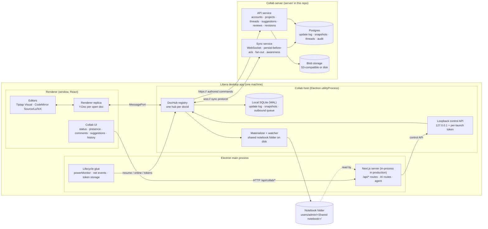

# Collaboration map

**Status:** planning reference, not yet implemented
**Last updated:** 18 Oct 2026

This is the high-level map of real-time collaboration in Libera. It shows what the pieces are, where they live in the repo, how data flows between them, and which existing features each one builds on. Read it before changing anything in the collaboration code.

Related documents:

- [source-plan.md](source-plan.md): the original product and architecture plan. Section numbers like "§3.2" in these documents refer to it.
- [implementation-plan.md](implementation-plan.md): the delivery plan for this repo, Phase 0 through Phase 4.
- `SETUP.md` (repo root, written in M1.0): how to run the collaboration server locally and in production.

---

## 1. Scope

The unit of sharing is a **shared notebook**. Its owner shares an existing notebook, or creates a new one, and invites members by email.

Inside a shared notebook:

| Kind | How it is shared |
|---|---|
| Markdown (`.md`, `.markdown`) | A collaborative document (CRDT) |
| LaTeX (`.tex`, `.bib`, `.sty`, `.cls`) and other text files the code editor opens | A collaborative document (CRDT) |
| Images, PDFs, other binaries (including Markdown `_assets/`) | Immutable blobs addressed by content hash. Replacing a file uploads a new blob. |
| Folder tree, file names, file IDs | The **project manifest** document |
| Comments, suggestions, reviews, history | Server API, plus anchors in the document's `annotations` sub-document |

Not shared in v1:

- PDF and image annotations (`.libera/annotations`)
- Tags, stars, notebook view options, AI chat history, image-generation settings
- Notebooks that are not shared, and linked (directory-mode) folders

All of these keep working locally exactly as they do today.

---

## 2. The picture



Three points to remember:

1. **The editor never waits on the network.** Keystrokes change the renderer replica. The host persists them to SQLite and sends them to the server in the background.
2. **The CRDT is the source of truth for shared files.** The files on disk are a working copy the host writes from the CRDT, so that search, backlinks, LaTeX builds, the agent's Grep/Read and other tools keep working. Edits made to those files by other programs are turned back into CRDT operations (§7). Nothing ever rebuilds a document from the file on disk.
3. **Every change has an author.** Text edits, comments, suggestions and decisions all carry an actor (see §4). This includes AI actions.

---

## 3. Components and where they live

| Component | Repo location (planned) | Runs in | Builds on |
|---|---|---|---|
| Protocol, document schema, actor types, version constants | `src/lib/collab/protocol/` (no React, DOM or Next imports) | Shared by renderer, host and server | — |
| Renderer replica and bindings | `src/lib/collab/client/`, `src/lib/collab/bindings/` | Renderer | `use-tiptap-draft.ts`, `latex-editor.tsx`, `code-editor.tsx` |
| Collab UI | `src/components/libera/collab/` | Renderer | `markdown-review-ui.tsx`, `tiptap-change-bar.tsx`, `latex-change-bar.tsx` |
| Local API routes for collab | `src/app/api/collab/*` | Next server | `requireAuth` in `src/lib/api.ts` |
| Collab host (DocHub registry, SQLite, sync client, materializer) | `electron/collab/` (TypeScript, bundled with esbuild to `electron/collab/dist/host.cjs`) | Electron `utilityProcess` | `node:sqlite` as used in `src/lib/search/database.ts` |
| Host lifecycle glue | `electron/collab-host.cjs` | Electron main | `server-lifecycle.cjs`, `state-flush.cjs`, `updater.cjs` |
| Collab server | `server/` (its own `package.json`, lockfile, Dockerfile) | Linux server (Docker) | — |
| Deployment configuration | `ops/collab/` (compose files, nginx site, backup scripts) | Server | `ops/nginx/`, `scripts/setup-update-server.cjs` |
| Tests | `scripts/collab/*.test.ts`, `server/test/` | CI | `npm run test:editor` harness (node:test, tsx, jsdom) |

**Why a utilityProcess and not the main process.** The source plan puts the DocHub in the main process (§2.2). In Libera, the production Next.js server already runs inside the main process (`electron/main.cjs`, `startNextServer`), so AI streaming and API requests share the main event loop. A dedicated utilityProcess keeps the three properties §2.2 wants:

- There is one owner per document per machine.
- SQLite is written before the UI is told "Saved on this device".
- The connection survives a renderer reload or crash.

It also keeps the 10 ms task budget away from the Next server. The main process restarts the host if it crashes. The SQLite WAL makes that safe.

---

## 4. Identity, actors and roles

### Two kinds of identity

- **The local app password** (`src/lib/auth.ts`, subject `admin`) stays as it is. It unlocks this machine's Libera.
- **A collaboration account** lives on the collab server: email, display name, password, and colour. The desktop app signs in to it once and keeps a refresh token encrypted with Electron `safeStorage`. One machine has one active collaboration account in v1.

### Actors (the "author API")

Every persisted change, comment, suggestion and decision is stored with an `Actor`:

```ts
type Actor =
  | { kind: "user"; userId: string; clientId: string }
  | { kind: "ai"; onBehalfOf: string /* userId */; clientId: string; feature: AiFeature; model: string; runId?: string }
  | { kind: "system"; reason: "restore" | "import" | "compaction" | "migration" };

type AiFeature = "rewrite" | "write" | "format" | "image-to-markdown" | "agentic-review" | "agent" | "review-comments";
```

Rules:

- The server takes `userId` and `onBehalfOf` from the authenticated connection, never from the request body.
- An AI actor never has more rights than the user it acts for.
- An AI actor can **comment and suggest**. It cannot **decide**: it cannot accept or reject suggestions or approve reviews.
- AI requests still run on the requesting user's machine, with that user's OpenRouter key. The server never sees AI keys or prompts. It stores only the resulting comments and suggestions, with their actor.

### Roles (per shared notebook)

| Action | Owner | Editor | Commenter | Viewer |
|---|:-:|:-:|:-:|:-:|
| Read documents, comments, history | ✓ | ✓ | ✓ | ✓ |
| Write `content` (edit text directly) | ✓ | ✓ | | |
| Write `annotations` (comment anchors, suggestion overlays) | ✓ | ✓ | ✓ | |
| Comment, reply, resolve own threads | ✓ | ✓ | ✓ | |
| Suggest (human or AI on their behalf) | ✓ | ✓ | ✓ | |
| Accept or reject suggestions; restore revisions | ✓ | ✓ | | |
| Add, rename, move and delete files (manifest) | ✓ | ✓ | | |
| Request reviews | ✓ | ✓ | | |
| Approve a review | Assigned reviewers, whatever their role ||||
| Invite members, change roles, delete the notebook | ✓ | | | |

The server enforces these rules on every update and command, per sub-document (§5). The UI only mirrors them.

---

## 5. Document model

Each shared text file is one root `Y.Doc` (with a stable `docId`, not its path) with three sub-documents:

| Sub-document | Contents | Who can write |
|---|---|---|
| `content` | `Y.Text("source")`: the file's exact text (Markdown or LaTeX source) | Editors |
| `annotations` | `Y.Map("anchors")`: comment anchors `{start, end}` as Yjs `RelativePosition`s. `Y.Map("suggestions")`: suggestion overlays (§8). `Y.Map("reviewScopes")`: anchored review scopes. | Editors, commenters |
| `meta` | `schemaVersion`, file kind, settings | Owners, editors |

The **project manifest** is one more document per shared notebook. It holds `Y.Map("files")` keyed by fileId, with `{path, kind: "doc" | "blob", blobHash?, createdBy}`. Renames and moves change only the manifest.

**Why plain source text and not a rich-text tree.** Everything in Libera already works on source text:

- Markdown and LaTeX files on disk
- Review anchors (UTF-16 source offsets)
- Agentic review edits (`{start, end, before, after}`)
- The agent's Edit tool (string replacement)
- LaTeX builds and SyncTeX

The Visual editor's Markdown round-trip also normalizes syntax (`markdown-review.ts`, `tiptap-review.ts` say so). A rich-text CRDT would make every one of those a lossy conversion. With `Y.Text`, the Source and LaTeX editors bind directly (y-codemirror.next), and the Visual editor uses a block-scoped bridge (§7.2).

Comment **thread content** (messages, mentions, status) lives in Postgres behind the API. Only the anchor lives in the document.

---

## 6. Durability states

Each shared tab shows one of these in place of today's unsaved-changes dot (§3.1 of the source plan):

| State | Shown when | Backed by |
|---|---|---|
| Saved on this device | Every local edit is in the SQLite log | The host's SQLite commit returned |
| Syncing… | Connected, N updates awaiting server ack | Outbound queue is not empty |
| Saved to workspace | Every local update acknowledged | Queue is empty and the last ack was received |
| Offline — N changes on this device | Not connected | Connection down |
| Read-only — update required | The document's schema is newer than this client | `meta.schemaVersion` |
| Access changed | Access was revoked or reduced | Server close code 4003 or a reject |

**Shared tabs have no Save.** Cmd/Ctrl+S on a shared tab only shows the status. Shared tabs never count as dirty in the updater's dirty-document count (`electron/updater.cjs`), because their edits are already in SQLite.

---

## 7. Data flows

### 7.1 Local edit (Source or LaTeX editor)

1. CodeMirror transaction → y-codemirror.next → renderer `Y.Text`. The update's origin is the local user, with a provenance tag for AI and paste actions.
2. Renderer → host over the `MessagePort` (batched every animation frame).
3. The host appends the update to `updates` in SQLite and commits. The tab shows **Saved on this device**.
4. The host batches updates (20–50 ms) and sends `update{clientSeq}` over the WebSocket.
5. The server checks the role for that sub-document, appends the update to `doc_updates`, assigns `serverSeq` and replies `ack`. The tab shows **Saved to workspace**.
6. The server sends `remote` to the other clients' hosts. They persist it, then forward it to their renderer replicas.
7. The materializer rewrites the working-copy file on disk (debounced, atomic rename), and `notifySearchChanges` updates the search index.

### 7.2 Visual (Tiptap) editing over `Y.Text`

The Visual editor keeps its own ProseMirror document. A **block bridge** (`src/lib/collab/bindings/tiptap-ytext.ts`) keeps it in step with `Y.Text`:

- **Local change.** The bridge finds the top-level blocks the transaction touched. It serializes only those blocks with the existing Markdown serializer and applies a character-level diff to their source range in `Y.Text`. Untouched blocks are never re-serialized, so normalization stays local to the block being edited.
- **Remote change.** The bridge finds the source blocks the `Y.Text` delta touched, reparses only those blocks, and replaces the matching ProseMirror nodes (`addToHistory: false`), mapping the local selection through. The block alignment already exists in `tiptap-review.ts`.
- **During IME composition** the bridge holds outgoing serialization and incoming replacements until composition ends. `use-tiptap-draft.ts` already skips during IME.
- **Remote cursors** are mapped from source offset to block, and then to an offset inside the block. This is approximate inside formatted inline text.

This is the riskiest piece. It is Phase 0 spike S1 and has a fallback (implementation plan, D1).

### 7.3 Disk working copy and external edits

- The host owns the shared notebook folder `users/admin/<name>/`. A `.libera-shared.json` marker in it records `{projectId, serverUrl, accountId}`.
- `PATCH /api/files` refuses writes to shared files with `409 shared-document`. Every Libera code path that writes text files must go through the host instead. That includes saving, the agent, OCR "Convert PDF to Markdown", and new-file creation.
- A watcher sees edits made by other programs. If the file still matches the last materialized hash plus the user's edit, the host diffs it into CRDT operations authored by the user (provenance `external-file`). If the document also changed remotely in the same region, the host opens a reconciliation view built on `@codemirror/merge` (already a dependency). The shared document is never overwritten from disk.
- Binary files: a new or changed file is hashed, uploaded as a blob, and recorded in the manifest. Remote blob changes are downloaded and written atomically.

### 7.4 Comments (Phase 2)

Selecting text and pressing Cmd/Ctrl+Alt+M (today's review-mode gesture) does three things:

1. Creates an anchor in `annotations` (two `RelativePosition`s plus `anchorId`).
2. Queues `createThread{anchorId, quote, body}` in `pending_commands`.
3. Sends the command to `POST /threads` once online.

The Comments panel (`markdown-review-ui.tsx`) reads threads from a `SharedReviewStore`. That store implements the same interface as today's local store, which reads `.libera/markdown-reviews.json`. Anchor states map onto today's states: `attached`, `orphaned` becomes **detached**, and `ambiguous` resolves by `RelativePosition` and no longer occurs.

### 7.5 Suggestions and decisions (Phase 3)

A suggestion is an **overlay** in `annotations`:

```ts
{ id, actor, anchor: {start, end},  // RelativePositions over the original text
  baseQuote,                        // the original text when the suggestion was made
  replacement,                      // proposed text ("" for a deletion)
  groupId?,                         // linked suggestions are accepted together
  status }                          // pending | accepted | rejected | stale
```

`content` stays the accepted truth. Builds, exports, disk copies and other readers see the text without pending suggestions.

- Commenters, and AI acting for any user, write only to `annotations`. No server command API is needed to *create* a suggestion.
- **Accepting** is a server command. The server checks that the text at the anchor still equals `baseQuote` (or marks the suggestion stale). It then applies the replacement to `content` once, as a trusted actor attributed to the decider, and broadcasts the change. Because the server serializes decisions, two reviewers deciding at the same time cannot apply a change twice.
- Rendering reuses the existing preview-mode tracked changes:
  - Visual editor: `tiptap-changes.ts` `mode: "preview"`, the path agentic review already uses.
  - CodeMirror: a new preview-mode extension next to `latex/codemirror/review.ts`.

### 7.6 AI features on shared documents

| Feature | Today | Shared document, Phase 1 | Shared document, Phase 3 |
|---|---|---|---|
| AI Rewrite / Write / Format / Image to Markdown | Client inserts the result as an applied tracked change (or splices it straight into the Source textarea) | Applied as the user's edit, provenance `ai:<feature>`. Reject is a local undo. | Creates a suggestion with actor `ai`, on behalf of the user |
| Agentic review (plan → proposals) | Proposals in `markdown-reviews.json`, applied to the snapshot on accept | Plan session stays private to the user. Accept applies the edit through the host as the user. | Proposals become suggestions with actor `ai`. Linked proposals share a `groupId`. |
| Leave review comments (agent skill) | `addReviewThreads` with `author: "agent"` | Local only. Disabled for shared documents until Phase 2. | Phase 2: creates threads with actor `ai` |
| AI Agent Edit/Write | `fs.writeFile` on the server, then `syncTabFromDisk` | Routed through the host control API as the user's edits (provenance `ai:agent`, `runId`). Undo becomes inverse edits. | Edits on shared files become suggestions. Agent undo withdraws its pending suggestions. |
| Document chat | Read-only, takes context from the client | Unchanged. Context comes from the replica. | Unchanged |

---

## 8. Storage

### Client (host SQLite, `userData/collab/<accountId>.sqlite`)

Same tables as the source plan's §5.1, plus:

- `docs(doc_id, project_id, file_id, path, materialized_hash)`
- `projects(project_id, name, local_root, role)`
- `blobs_cache(hash, local_path, size)`

### Server (Postgres)

Same tables as the source plan's §5.2, plus:

- `accounts`, `refresh_tokens`, `projects`, `invitations`, `blobs(hash, size, mime, created_by)`, `notifications`
- `commands(id, actor, kind, payload, idempotency_key UNIQUE, result, at)`, which makes offline command replays idempotent

`threads`, `messages`, `suggestions` and `review_assignments` store a full actor (`actor_kind`, `user_id`, `on_behalf_of`, `ai_feature`, `model`).

---

## 9. Reuse map

| Existing piece | Where | Reused for |
|---|---|---|
| Tracked changes (preview and applied modes, change bar, keyboard shortcuts) | `src/lib/tiptap-changes.ts`, `tiptap-change-bar.tsx` | Rendering suggestions and AI proposals in the Visual editor |
| CodeMirror review hunks | `src/lib/latex/codemirror/review.ts`, `latex-change-bar.tsx` | Basis for the CodeMirror suggestion overlay (preview mode added) |
| Review mode, comments panel, threads, reattach, search | `markdown-review-ui.tsx`, `markdown-review-context.tsx`, `src/lib/markdown-review.ts` | Shared comments UI over a `ReviewStore` interface |
| Agentic review plan and proposal loop | `src/lib/markdown-review-ai.ts`, `/api/document-review` | Unchanged prompts. Output becomes AI suggestions. |
| Agent tools, permissions, run snapshots | `src/lib/agent/*` | Shared-file writes routed to the host. Permission capped at "suggest" in shared notebooks. |
| Block alignment between remark and ProseMirror | `src/lib/tiptap-review.ts` | Visual-mode block bridge |
| `@codemirror/merge` | dependency | Reconciliation view, revision diffs, review "changes since" |
| `node:sqlite` loading and packaging | `src/lib/search/database.ts`, `electron/prepare-dist.cjs` | Host SQLite |
| Background-process pattern, env injection | `electron/main.cjs`, `search-worker.mjs` | Host process, `LIBERA_COLLAB_HOST_URL` / `_TOKEN` |
| Shutdown flush, updater dirty gating | `electron/state-flush.cjs`, `electron/updater.cjs` | Flushing the host on quit; shared tabs are not dirty |
| NDJSON streaming | `src/lib/text-stream.ts` | Unchanged for AI. Collab uses WebSocket and MessagePort. |
| nginx + certificate setup on the update server | `ops/nginx/`, `scripts/setup-update-server.cjs` | Collab server site and certificates |

---

## 10. Security boundaries

- **Permissions are enforced on the server**, per sub-document and per command. The client's role is a hint for the UI.
- **Content from collaborators is untrusted.** This covers Markdown, comments, file names and LaTeX.
  - Rendering must sanitize HTML. The Markdown preview's raw-HTML handling needs a review for shared documents.
  - LaTeX builds keep `shell_escape=f` and `openin_any=p`.
  - Manifest paths are validated server-side and again by the host (no `..`, no absolute paths, no reserved names on Windows).
- **AI prompt injection.** A collaborator can write text meant to steer another user's AI. This includes an `AGENT_NOTES.md` in a shared notebook. That is why the agent's power in shared notebooks is capped at suggestions (Phase 3; before that, at edits the user can see and undo). It is also why AI can never decide.
- **Tokens.**
  - Access tokens are short-lived JWTs (15 min). Refresh tokens rotate and are stored with `safeStorage`.
  - The host control API binds to 127.0.0.1 and requires a per-launch random bearer token.
- **Renderer hardening.** The main, setup and export windows run with `sandbox: true`, and collaborator Markdown goes through an allowlist sanitizer (`src/lib/markdown-sanitize.ts`). See [security.md](security.md).

---

## 11. Decisions

Proposed defaults. The implementation plan records each one's spike and fallback. Confirm or change them at the end of Phase 0.

| ID | Decision | Proposed |
|---|---|---|
| D1 | Document model | Source text (`Y.Text`) for Markdown and LaTeX. Visual editor through the block bridge. |
| D2 | CRDT | Yjs (+ y-protocols, y-codemirror.next) |
| D3 | Sync server | Custom Node server on y-protocols + `ws` (Hocuspocus has no per-update persist-before-ack) |
| D4 | Tracked changes | Build: overlay suggestions on the existing preview-mode renderers. No paid component. |
| D5 | Local persistence | `node:sqlite` in WAL mode in the collab host |
| D6 | Compaction | Client: snapshot every 500 updates or 1 MB of log. Server: snapshot every 2,000 updates. Keep the full log for 90 days, then keep only revision snapshots. |
| D7 | Host process | Electron `utilityProcess`, not the main process |
| D8 | Markdown Source editor | Port the textarea editor to CodeMirror 6 (`@codemirror/lang-markdown` is installed) |
| D9 | Server stack | Node 22 + TypeScript, Fastify, `ws`, Postgres via Kysely, S3-compatible blobs (MinIO in development) |
| D10 | Hosting | Self-hosted on the existing Libera VPS behind nginx (`collab.libera.intuelle.com`) |
| D11 | Sharing unit | Shared notebook |
| D12 | AI in shared notebooks | Runs locally with the user's key. AI is an attributed actor that may comment and suggest, never decide. |

---

## 12. Glossary

- **Host:** the collab utilityProcess on a desktop machine.
- **DocHub:** the host's owner object for one open document.
- **Replica:** a renderer's `Y.Doc` mirror of a DocHub.
- **Materialize:** write the CRDT's text to the working-copy file on disk.
- **Overlay suggestion:** a proposed replacement stored in `annotations`. It is applied to `content` only when someone accepts it.
- **Provenance:** a tag on a local edit saying how it was produced (`typing`, `paste`, `ai:rewrite`, `external-file`, …). It is kept in history for attribution.
- **Actor:** who an action is attributed to: a user, AI acting for a user, or the system.
