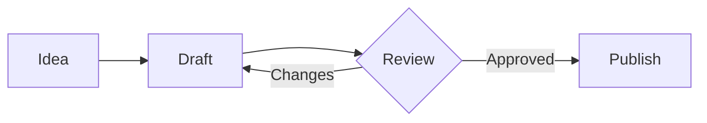

# Charts, diagrams and live HTML

Three kinds of fenced code block draw something instead of showing code, in
notes and in slide decks alike:

- ```` ```chart ```` draws a chart from a few lines of settings.
- ```` ```mermaid ```` draws a diagram (flowchart, sequence, class, state,
  entity-relationship, Gantt, pie, mind map, timeline and more) from Mermaid
  text.
- ```` ```html live ```` runs its HTML, CSS and JavaScript like a small web
  page, for interactive figures, calculators or custom charts.

Any other code block, including a plain ```` ```html ````, stays code.

## Where they render

| Place | Charts, diagrams and live HTML |
| --- | --- |
| Visual editor | Under the block's code, which stays editable. Redrawn half a second after you stop typing. |
| Source editor | In the preview beside the source (and in fullscreen preview). The source itself shows the code. |
| Preview window | Yes. |
| PDF export | Yes. Libera waits for each chart, diagram and frame to finish drawing before printing. |
| Slides | In the preview, the presentation and the PDF. |
| AI chat, search results, citation cards | No. They show the code, so HTML from those places never runs on its own. |

In notes, colors follow the app's light or dark theme and change with it. In
slides, they follow the deck's `$theme`.

In the Visual editor, **Insert chart**, **Insert diagram** and **Insert
interactive HTML** in the toolbar add a starter block. Typing ```` ``` ```` there makes a plain code
block, which cannot carry the `live` flag, so use the buttons, or write the
fence in the Source editor.

## Charts

````markdown
```chart
type: bar
title: Revenue by quarter ($k)
labels: [Q1, Q2, Q3, Q4]
series:
  2025: [12, 19, 8, 15]
  2026: [14, 22, 11, 18]
```
````

Settings are YAML or JSON. Charts use a colorblind-safe palette, have hover
tooltips, show a legend when there are two or more series, and include a table
of the data for screen readers.

- `type`: `bar` (default), `line`, `area`, `pie`, `doughnut`, `scatter`,
  `bubble`, `radar` or `polarArea`.
- Data comes from `labels` plus `series` (a name for each list of values, or
  one plain list), or from `data`. `data` can be CSV text (`data: |` with the
  rows indented) or the path of a `.csv`/`.tsv` file next to the note or deck,
  such as `data: sales.csv`. The path cannot leave the notebook. In CSV, the
  first column labels the points and each other column is a series; empty or
  non-numeric cells are gaps. For `scatter`, the first column is x.
- `title`, `x` and `y` (axis titles), `stacked`, `horizontal`, `smooth`,
  `legend` (`top`, `bottom`, `left`, `right` or `none`), `height` (pixels, 300
  by default), `min`/`max`, `beginAtZero` (`false` lets the axis start
  elsewhere) and `colors` (CSS colors; quote hex values, as in `["#0d9488"]`,
  because YAML reads `#` as a comment).
- `options` is merged into Chart.js's own options, and `datasets` replaces
  `series` with Chart.js datasets, for anything the shorthand does not cover.
- A mistake in the settings, or a data file that cannot be read, shows a
  message in place of the chart.

Charts are data only, so they render in every notebook, shared ones included.

## Diagrams

````markdown

````

The block holds [Mermaid](https://mermaid.js.org/intro/) text, the same syntax
GitHub and many other Markdown tools draw. The first line names the kind of
diagram: `flowchart`, `sequenceDiagram`, `classDiagram`, `stateDiagram-v2`,
`erDiagram`, `gantt`, `pie`, `mindmap`, `timeline`, `journey`, `gitGraph`,
`quadrantChart`, `xychart-beta`, `block-beta` and others Mermaid supports.

- Colors come from the theme: node borders and pie slices use the chart
  palette, fills are pale tints of it, and text uses the theme's text color.
  A diagram's own `%%{init: …}%%` line or `config:` front matter can still
  change Mermaid's settings.
- A diagram is as wide as Mermaid draws it, and shrinks to fit a narrower note
  or slide. Its text is the size of the text around it, so on a slide it
  follows `$fontsize`, and a slide that is too full shrinks the
  diagram along with the text.
- Images in labels load like a note's: in a shared notebook only `https:`
  images, so a collaborator cannot make readers fetch other addresses.
- `accTitle:` and `accDescr:` lines give the diagram a title and description
  for screen readers.
- A mistake in the text shows Mermaid's message in place of the diagram. In
  the Visual editor, the last good drawing stays up while you type.

Diagrams run in Mermaid's strict mode: `click` lines that call scripts or open
links, and HTML inside labels, are ignored, and the drawing is sanitized again
before it is shown. So, like charts, diagrams render in every notebook, shared
ones included. For a diagram that needs scripting, use live HTML and load
Mermaid from a CDN.

## Live HTML

````markdown
```html live height=320
<div style="height:300px"><canvas id="growth"></canvas></div>
<script>
  new Chart(document.getElementById("growth"), {
    type: "line",
    data: { labels: [1, 2, 3, 4], datasets: [{ label: "Users", data: [3, 7, 12, 20], borderColor: libera.colors[0] }] },
    options: { maintainAspectRatio: false },
  });
</script>
```
````

- Chart.js is already loaded as `Chart`.
- `libera.colors` is the series palette and `libera.theme` holds the theme's
  colors (`foreground`, `muted`, `rule`, `surface`), its `name` and whether it
  is `dark`. `libera.mode` is `preview`, `presenter` or `export`.
- The block grows to fit its content. Add `height=400` after `live` for a
  fixed height.
- A responsive Chart.js canvas is half as tall as it is wide. Wrap it in a
  `<div>` with a height and pass `maintainAspectRatio: false` to set the
  height yourself.
- Each block starts when it first scrolls into view.
- Script errors show under the block (not in PDF exports).
- In a presentation, keys pressed inside the block still move the slides,
  unless focus is in a text field.

### Safety

The code runs in a sandboxed frame with its own opaque origin. It has no access
to Libera, your files, your session or the page around it.

- **Your own notebooks:** the block may load scripts, styles, images, fonts and
  data over `https:`. Nothing else is reachable, so pictures from the notebook
  need an `https:` or `data:` URL.
- **Shared notebooks:** the block shows a **Run** button instead of running on
  its own, and it never gets network access. PDF exports of a shared notebook
  print the button's placeholder instead.

## How it works

- `src/components/libera/slide-live-blocks.tsx` holds the renderers
  (`SlideChart`, `SlideDiagram`, `SlideLiveHtml`, picked by `SlideLiveBlock`),
  `isLiveCodeBlock`, and the notes' wrapper
  (`NotebookLiveBlock`, `useNotebookCodeBlockRenderer`), which takes the theme
  from the root element's `dark` class.
- `MarkdownRenderer` hands each fenced block to its `renderCodeBlock` prop.
  The note preview, the preview window, PDF export and slides pass one; other
  callers do not, which is why chat and search show code.
- The Visual editor's code block (`src/components/libera/tiptap-live-code-block-view.tsx`)
  is a React node view. The block's `language` attribute keeps the whole info
  string (`html live height=320`), so the flag survives a Visual edit and is
  written back to the Markdown unchanged.
- `src/lib/slide-diagrams.ts` maps the theme to Mermaid's `base` theme
  variables. Mermaid is loaded only when a page has a diagram, and its
  configuration is global, so diagrams render one at a time, each with its
  own theme.
- `src/lib/slide-charts.ts` parses chart settings and builds the Chart.js
  configuration. `/api/slide-libraries/chart` serves Chart.js to live frames,
  which cannot load scripts from the app.
- Notes map the slide color variables to the app theme with the
  `.markdown-notebook-block` class in `src/app/globals.css`.
- The Libera agent learns these blocks from its `visualization-interactivity-in-markdown`
  and `slide-deck` skills (`src/lib/agent/skills/`), which share their
  reference and a finish check in `live-blocks.ts`.
