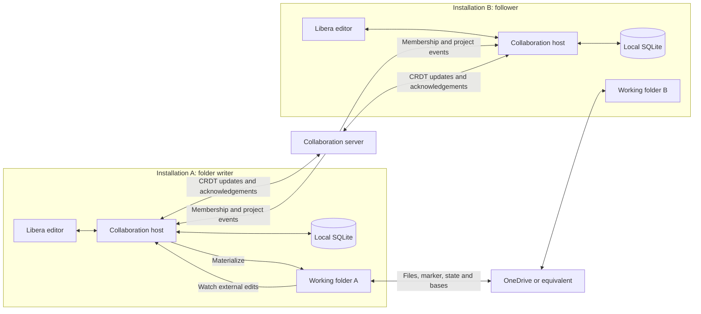

# Notebook sync: behavior and edge-case reference

Reviewed: 1 November 2026. Applies to shared notebooks and to their working folders copied between one person's devices by OneDrive, iCloud Drive, or a similar service.

This document separates **how the code currently works** from the **required behavior** in the matrices. A required behavior is not a claim that it is implemented. `Fixed Gxx` identifies a resolved finding and its regression evidence in the [first sync review](../audits/2026-11-01-collaboration-sync-review.md) or [follow-up review](../audits/2026-11-01-notebook-sync-follow-up.md). `Covered` means an automated test passes for that specific case; `Unverified` means the combination still needs a test. Tests using one physical folder do not establish correctness for independently delayed copies on two devices.

**G01–G29 are fixed**, with regressions included in normal test suites. The [transition review](../audits/2026-11-01-sync-transition-review.md) reproduces **five additional open findings (G30–G34)** involving deletion archiving, interrupted rename recovery, join root replacement, cancelled queued operations and album revocation cleanup. The [lifecycle review](../audits/2026-11-01-sync-lifecycle-review.md) records operation-bound project creation, guarded text/create commits, initial-share root protection and account/server-bound recovery checkpoints. The [boundary review](../audits/2026-11-01-sync-boundary-review.md) records binary preservation, authority-isolated databases and sync identities, validated scan operations, retired paths and bounded REST work. Unverified combinations remain explicitly listed below; these fixes do not establish correctness for every real cloud provider or filesystem.

## How the two sync paths work

Both installations can edit through their hosts if the account has permission. A follower receives live text through the collaboration server, while its files arrive through the cloud provider. It does not materialize files, save folder state, or import external disk edits until it becomes the writer. Each installation keeps its collaboration SQLite database outside the synced working directory.

| Item | Current responsibility | Source |
|---|---|---|
| Text documents | One Yjs document per file; local updates persist in SQLite before delivery to peers; server acknowledgement follows server persistence. | [host](../../electron/collab/core/host.ts), [document hub](../../electron/collab/core/doc-hub.ts), [server persistence](../../server/src/sync/store.ts) |
| File tree | A manifest maps stable file IDs to paths, document IDs, or blob hashes. Renaming changes a path, not a text document's identity. | [schema](../../src/lib/collab/protocol/schema.ts), [layout](../../electron/collab/notebooks/layout.ts) |
| Binary files | Upload immutable bytes by SHA-256, then publish their hash in the manifest; downloads verify the hash. | [blob client](../../electron/collab/core/api-client.ts), [blob routes](../../server/src/api/blobs.ts) |
| Working folder | Writer materializes shared state; watcher imports external edits. Concurrent text changes open reconciliation; removed notebook files go to `_archive`. | [project runtime](../../electron/collab/notebooks/project.ts) |
| `.libera-shared.json` | Records project, account, server, manifest, folder identity, writer and revocation. Storage guards use it to prevent direct writes. It travels independently of the files it describes. | [marker](../../electron/collab/notebooks/state.ts), [storage guard](../../src/lib/collab/shared-notebook.ts) |
| `.libera/collab/state.json` and `base/` | Last materialized paths, hashes, limited previous versions, merge bases and reconciliations. These are working-copy bookkeeping, not proof that all cloud files have arrived. | [state](../../electron/collab/notebooks/state.ts) |
| Writer lease | Per project, account and folder ID. Default TTL is 60 seconds, checked about every 20 seconds. A connected contender can take over after expiry. | [lease client](../../electron/collab/notebooks/service.ts), [lease server](../../server/src/api/projects.ts) |
| Database authority and retired paths | SQLite is scoped by normalized server URL and account. Its durable ownership and retired-path records stay outside the cloud folder; verified legacy databases retain their pending work and client identity. | [database selection](../../electron/collab/control/databases.ts), [store](../../electron/collab/core/store.ts) |
| Local binding/lifecycle records | Profile-local `userData/collab/notebook-lifecycle`, outside the synced library. Remember the current root identity and confirmed local/revoked outcomes; the host and Next guard share them through `LIBERA_COLLAB_LIFECYCLE_DIR`. | [local records](../../src/lib/collab/local-notebook-state.ts), [Electron environment](../../electron/collab-host.cjs) |
| Automatic account sign-in | An encrypted device grant in the synced library starts a separate session on each device; refresh tokens are not shared. | [shared sign-in](../../electron/collab/control/shared-sign-in.ts), [credential review](../collaboration/credential-sync-review.md) |

**Current offline lease policy:** automatic folder work requires an unexpired confirmed lease, checked with a conservative monotonic deadline. After expiry or sign-out, disk imports/materialization pause and the installation follows, even if its marker still names it. Editor changes remain durable in SQLite, and explicit collaborative operations keep the normal follower permissions. External disk bytes wait for authorized observation/reconciliation. A server without writer-lease support also cannot authorize automatic folder work. This fixes G11 without forbidding follower editing.

REST requests have a 60-second application deadline, including token acquisition and response bodies. Lease acquisition is bounded by five seconds (or one-third of the lease TTL when shorter); release is best effort with a one-second deadline. Account changes and shutdown cancel outstanding host requests before waiting for background work.

A deleted or renamed path remains retired in local SQLite. Unexplained disk files returning at that path are archived instead of automatically shared again. An explicit collaborative create can reuse the name; unrelated new disk files still import normally.

## Distinguish identities and lifecycle actions

| Term | Meaning | Consequence |
|---|---|---|
| Owner/editor/commenter/viewer | The account's permission in the project. | Controls shared reads and writes; independent of writer/follower status. |
| Writer/follower | Which installation handles this particular cloud-synced folder. | A follower can still edit through the CRDT; a viewer can hold the disk-writer lease without permission to publish edits. |
| Same folder | Same server, project, account and `folderId`; different local absolute paths are normal across devices. | Its installations contend for the same lease. A separate invitation join creates another folder ID. |
| File delete | Remove an entry from the shared manifest. | Applies to all members. Text documents are tombstoned on the server; the notebook keeps recovery copies locally. |
| Local notebook delete | Remove one working folder. | Must never imply deleting every shared file or the server project. The current UI requires leaving or taking down an active share first. OneDrive may propagate the folder removal to the account's other devices. |
| Leave / member removed | This account loses project membership. | Stop future shared reads/writes; keep a read-only recovery copy of a notebook, which the user may delete. Other accounts remain members. |
| Take down | The owner deletes the server project. | Stop sharing for everyone. The owner's current content becomes a local notebook; members retain recovery copies. |
| Rejoin | A fresh server-authorized membership after leaving/removal. | Restore live access with a fresh baseline; preserve the previous recovery folder separately. Rejoining a deleted project is impossible; sharing again creates a new project ID. |

## Required invariants

1. **Server authority:** membership and project deletion come from the server. Recheck authorization when a queued open or mutation actually takes effect, including after waits.
2. **Durability:** distinguish saved in SQLite, acknowledged by the server, and materialized to disk. None implies that another device's cloud copy is complete.
3. **No inferred cloud deletion:** a missing file during adoption, takeover, placeholder hydration, or incomplete scanning is not sufficient evidence of a user's shared-delete intent.
4. **Identity at commit:** after asynchronous uploads/downloads or retries, recheck the project, folder identity, entry identity, current path and writer generation before writing or publishing. A stopped/demoted runtime must not commit stale work.
5. **No resurrection:** a late upload, stale marker or offline rename must not restore a deleted file/project or undo a completed rename. Unknown bytes remain recoverable without silently becoming shared truth.
6. **Preserve the latest content when sharing ends:** freeze new shared mutations, flush or export the current CRDT content, and retain a discoverable recovery mapping before removing the marker/project mapping. This applies to the initiating device and every receiving device.
7. **Deletion remains possible after access ends:** a lost or offline former writer must not permanently prevent deleting the account's local recovery copy.
8. **Rejoin resets access deliberately:** verify current server membership, clear stale access-revoked state on authorized hubs, refresh their roles, and separate pre-revocation unsynced work for recovery rather than blindly publishing it.
9. **Recovery makes progress:** a transient server persistence error must retry the same persisted batch safely even if WebSocket pings still succeed. Permission errors require an access transition, not endless retries.
10. **Corruption fails safely:** malformed, foreign, conflicting or partially delivered marker/state files must not authorize direct local writes, destructive manifest changes, or silent adoption into another account/project. Preserve the data and expose a recoverable state.

## Matrix A: changes arriving through OneDrive or the working directory

These cells describe required behavior when a shared notebook's **disk** changes. They include Finder/Explorer and external-editor changes. A follower's Libera editor uses Matrix B. OneDrive itself may still move/delete bytes outside Libera's control.

`Offline` means the collaboration server cannot be reached. `Cloud uncertain` includes delayed, missing, placeholder, stale, conflicting or malformed cloud files. `Taken down` refers to a confirmed server deletion: the owner's folder is local, and members' folders are recovery copies.

| Disk operation | Joined writer, online | Joined follower, online | Server offline | Cloud uncertain / corrupt | Account left / removed | Notebook taken down | Notebook rejoined |
|---|---|---|---|---|---|---|---|
| Modify text | Import a real external edit; reconcile concurrent shared text. | Do not import; retain external bytes for the writer/recovery. | Preserve bytes and local text; defer uncertain imports. | Validate identity and merge base; do not turn an old delivery into an edit. | Keep as recovery/local bytes; never publish to the former share. | Owner edits locally; member copy stays separate. | Establish current baseline before importing disk differences. |
| Replace binary | Upload first, then update the current file entry. | Do not upload the cloud copy as a new edit. | Keep bytes; report upload unavailable without publishing a missing hash. | Verify SHA-256 and file identity; preserve conflicting bytes. | No former-project upload. | No old-project upload. | Upload only against the currently authorized entry/path. |
| Delete file | Publish only an intentional deletion after a complete scan and grace period. | Do not infer shared deletion from disk absence. | Preserve deletion intent separately from uncertain cloud absence. | Do not publish deletion from missing/unhydrated files. | Delete only the local copy. | Delete locally; do not contact the deleted project. | Respect server tombstones; stale copies do not restore entries. |
| Rename / move file | Preserve file/document IDs; distinguish rename from delete/create. | Let the writer handle cloud changes; do not duplicate the rename. | Retain explicit intent; revalidate after reconnect. | Do not infer identity solely from arrival order or an old path. | Local recovery-folder changes only. | Local change only. | Resolve against the current manifest, not the previous recovery folder. |
| Create file | Create/upload once; publish a valid entry only after server creation succeeds. | Keep bytes local until the writer can safely classify them. | Keep bytes; creation needing server HTTP remains unavailable. | Do not import cloud conflict copies or system files automatically. | No new shared entry. | Ordinary local creation for owner. | Import only after current membership and baseline are ready. |
| Delete whole notebook folder | Stop disk work; do not clear the shared manifest. | Stop using the absent root; do not delete shared entries. | Do not recreate the root from pending work. | Missing or replaced root is unavailable, not an empty notebook. | Local removal is allowed; no former-writer dependency. | Local removal is allowed; stale markers must not relock it. | Do not resurrect a deliberately removed/replaced old folder. |

Existing tests cover ordinary external edits/renames, some stale copies, and missing roots at operation entry. Startup/takeover restores files absent from the incoming baseline (G02). Expired leases and incomplete walks no longer authorize inferred deletes (G11/G12). Guarded writes recheck identity after waits and never recreate a missing root (G08); unreadable or conflicting markers keep ordinary storage writers guarded (G15). Durable local lifecycle records prevent late markers from undoing confirmed deletion-unlock decisions (G19), while newer active bindings stay protected. Unknown older/equal-mtime text opens reconciliation; watch/ctime and periodic verification prevent preserved attributes from hiding changes indefinitely (G16/G17). The exact combinations below are the coverage authority.

## Matrix B: changes arriving through collaborative updates

The server is the transport for shared text, manifest operations, permissions and lifecycle events. Structural operations that need HTTP creation/upload are not promised to work offline; an explicit unavailable result must preserve user work and must not publish dangling references.

| Collaborative operation | Joined writer, online | Joined follower, online | Server unavailable | Cloud uncertain / corrupt | Account left / removed | Notebook taken down | Notebook rejoined |
|---|---|---|---|---|---|---|---|
| Modify text | Persist locally, sync, then materialize. | Persist/sync through CRDT; leave disk to writer. | Keep durable pending edits; retry after authorization is checked. | CRDT text can continue when its identity is known; isolate uncertain disk imports. | Stop future sync; retain rejected/offline work for export. | Keep the last local/shared text before detaching; no old-project writes. | Reopen authorized hubs; use current role and server state. |
| Replace binary | Upload first; update the latest entry at its current path. | Publish through host; writer materializes. | Report unavailable; do not publish an absent blob. | Verify bytes; do not overwrite foreign/replaced roots. | Refuse old-project upload or publication. | Refuse old-project upload or publication. | Only current authorized entries can be replaced. |
| Delete file | Remove manifest entry, tombstone text doc, archive latest text. | Same shared delete; writer handles disk. | Queue explicit existing-entry deletion; revalidate on reconnect. | Shared tombstone remains authoritative; stale files cannot restore it. | Refuse shared deletion; local recovery removal remains possible. | No deleted-project mutation. | A deleted old doc stays deleted; restoration creates a new file. |
| Rename / move file | Preserve stable IDs; do not overwrite a concurrent blob hash/path. | Update manifest through host; follow new path. | Queue existing-entry intent; resolve against current server state. | Cloud filename does not override current manifest identity. | Refuse shared rename. | No old-project rename. | Use the new live folder/index, not the recovery copy. |
| Create file | Create document/blob, then manifest entry; retry without duplicates. | Same via host; writer materializes. | HTTP-dependent creation is unavailable; keep input recoverable. | Do not materialize into a removed/replaced root. | Refuse shared creation. | Owner may create local files; a new share needs a new project ID. | Creation starts after authorized join and baseline. |
| Delete notebook from UI | Require owner takedown or member leave first. | Same account action; follower status is irrelevant. | Report lifecycle request unavailable; no false success. | Do not trust an old marker over confirmed lifecycle state. | Allow deleting the local copy. | Allow deleting the local copy immediately after cleanup. | Active membership again requires leave/takedown before UI deletion. |
| Take down notebook | Owner deletes server project; finish current local content first. | Owner may take down; do not depend on an offline writer to unlock the folder. | Keep sharing state until deletion is confirmed; handle a lost response idempotently. | Never remove another project's marker; retain local content. | Non-owner cannot take down the old share. | Cleanup is repeatable even after missed events or restart. | A deleted project cannot be rejoined; share again uses a new ID. |
| Leave / member removed | Stop access; preserve notebook recovery copy. | Same, including a locally deletable recovery state. | Recheck access on return; never upload revoked work as authorized. | Local recovery state must not wait forever for a marker from another device. | Repeated cleanup is safe. | Do not confuse member recovery with owner-local conversion. | Clear old access state only after fresh server authorization. |

## Interaction matrix and coverage

These rows cover combinations that a single-axis table cannot express. `Covered` is limited to the named test; it does not imply every timing or operating system has been checked. G01–G29 are fixed and covered by passing regressions. The [follow-up report](../audits/2026-11-01-notebook-sync-follow-up.md) preserves the failure evidence and records the implemented corrections. Unverified portions remain explicitly marked.

| ID | Combined conditions / event order | Required result | Evidence / status |
|---|---|---|---|
| X01 | `open` passes access check → waits in room queue → owner removes member → queued open resumes. | Refuse the open and all subsequent writes; no future content delivery. | **Fixed G01**; [server race reproduction](../../scripts/collab/audit/server-membership-race.mjs). |
| X02 | Follower has marker + state + full CRDT, but one cloud file is absent → writer stops → follower takes over. | Materialize or wait/reconcile; do not emit a shared delete. | **Fixed G02**; `writer takeover does not interpret a not-yet-synced file as a deletion`. |
| X03 | Text saved/acknowledged → materialization debounce pending → another device takes notebook down. | Returned local notebook contains the latest text, with conflicts preserved. | **Fixed G03**; `remote takedown preserves text newer than the debounced disk copy`. |
| X04 | Member's follower is joined → former writer stops → account removed before follower takes over. | Local recovery copy is deletable without former writer/cloud marker delivery. | **Fixed G04**; `revoked follower can delete its local notebook without its former writer`. |
| X05 | Empty notebook shared → device stops → other device takes it down → original restarts. | Confirm missing project; clear active share/marker even at server sequence zero. | **Fixed G05**; `a returning device cleans up an empty notebook taken down while it was stopped`. |
| X06 | Account removed → hubs persist access-revoked → fresh invitation accepted. | Fresh live sync and permissions work; previous recovery folder stays separate. | **Fixed G06**; `rejoining after removal clears the persisted access revocation`. |
| X07 | Blob replacement waits on upload → collaborator completes rename → upload returns. | Preserve completed rename and publish replacement at current path. | **Fixed G07**; `a delayed blob replacement respects a completed remote rename`; deletion during upload is also covered in [recovery tests](../../scripts/collab/notebooks-sync-recovery.test.ts). |
| X08 | Blob download begins → local notebook is deleted/moved/replaced → download returns. | Cancel stale write; do not recreate or write into the old/replaced root. | **Fixed G08**; `an in-flight blob download never recreates a deleted notebook root` covers deletion; [recovery tests](../../scripts/collab/notebooks-sync-recovery.test.ts) also cover a foreign replacement root. |
| X09 | Open editor → owner changes member to viewer/commenter/editor. | Hubs, renderer permissions, file routes and status agree immediately. | **Fixed G09**; `live role changes reach document metadata used by the editors` covers downgrade and promotion. |
| X10 | Durable update sent → server persistence throws → `internal` error → pings succeed. | Retry persisted bytes with the same batch identity; eventually acknowledge or show an actionable failure. | **Fixed G10**; `an internal save error retries on an otherwise healthy connection`. |
| X11 | Ordinary external text edit; concurrent external and shared text edit. | Import once; concurrent versions open reconciliation. | **Covered** in [notebooks-sync](../../scripts/collab/notebooks-sync.test.ts). |
| X12 | Recent known old bytes arrive with original mtime; user deliberately restores same text with new mtime. | Suppress known stale delivery; accept intentional edit. | **Covered** in [synced-folder tests](../../scripts/collab/notebooks-synced-folder.test.ts); finite-history limits remain X17. |
| X13 | Follower initiates takedown; server deletion succeeds but HTTP response is lost and former writer is stopped. | Confirm deletion and finish local cleanup safely; allow later new sharing. | **Covered** for combined follower/lost-response timing in [follow-up tests](../../scripts/collab/audit/sync-followup-edge-cases.mjs), plus existing [takedown](../../scripts/collab/notebooks-takedown.test.ts) retry coverage. |
| X14 | Two independent cloud folders; writer cannot renew; follower acquires expired lease; neither has the other's new marker. | Both retain local work; stale writer cannot publish cloud-derived deletes or overwrite the new writer's bookkeeping. | **Fixed G11**. Automatic disk work stops at lease expiry, including an upload completing later; explicit follower rename still works. |
| X15 | Marker/state malformed or cloud conflict copies appear; scan is incomplete or reaches its entry cap. | Preserve bytes; mark scan/state uncertain; never interpret unvisited entries as deleted. | **Fixed G12–G15**. Incomplete scans defer mutations; invalid state is preserved; startup errors are contained; unreadable markers stay guarded. Real provider conflict-copy/hydration behavior remains **Unverified**. |
| X16 | Completed takedown → sign out → late old marker arrives; confirmed member revocation → stale active marker; or root renamed while store names old path. | Preserve confirmed lifecycle decisions; keep recovery copies deletable; reconcile a unique compatible moved root or expose recovery. | **Fixed G18/G19**. Unique compatible roots rebind; local terminal records override stale markers; active newer identities remain guarded. Restart and stopped-host guard behavior also have boundary coverage. |
| X17 | Old copy older than eight remembered hashes, clock skew, preserved mtimes, same-size/coarse-mtime overwrite, or missing base. | Avoid silent rollback; preserve conflict and request reconciliation when origin is ambiguous. | **Fixed G16/G17** for history eviction and equal size/mtime overwrites. Missed-watch/frozen-stat verification is also covered. Broader clock-skew and missing-base combinations remain **Unverified**. |
| X18 | Offline edits exist at revocation → account later rejoins; a new project uses the same requested notebook name. | Keep pre-revocation work exportable; never replay it into a different identity or silently overwrite current text. | **Covered** for same-project recovery, same-name re-sharing with separate recovery folders, and same-root re-sharing with an old marker replay. See [recovery](../../scripts/collab/notebooks-sync-recovery.test.ts) and [boundary tests](../../scripts/collab/notebooks-followup-recovery.test.ts). Arbitrary forced root replacement remains **Unverified**. |
| X19 | Shared text file deleted remotely while another member has unsynced edits/open tab. | Tombstone shared file; keep latest local text and recovery view without revoking whole notebook. | **Covered** in [notebook lifecycle](../../scripts/collab/notebooks-lifecycle.test.ts) and [server documents](../../server/test/sync-documents.test.ts). |
| X20 | Interruption during share, then retry, including another account/server or simultaneous checkpoint copies. | Reuse planned IDs/uploads only within the recorded authority; refuse incompatible plans without losing them; use one writer lease. | **Fixed G25/G29**; [share retry](../../scripts/collab/notebooks-share-retry.test.ts) and [checkpoint recovery](../../scripts/collab/notebooks-share-lifecycle-recovery.test.ts). Covers lost responses, legacy plans and fault-injected upload/checkpoint boundaries; full process/power-loss crashes remain **Unverified**. |
| X21 | One saved layout contains a null/invalid record → restart with other healthy shared notebooks. | Quarantine the invalid state; start healthy notebooks; keep initialization retryable. | **Fixed G13**. Exact invalid bytes are retained; the baseline rebuilds; healthy notebooks and lease polling start. |
| X22 | A new cloud folder has marker IDs/account but no valid server URL → another valid cloud folder follows it in discovery. | Reject that marker locally and continue discovery with a visible recoverable state. | **Fixed G14**. Full marker validation and per-folder error containment; diagnostics identify unreadable markers or ambiguous copies. |
| X23 | Live share → truncated/unreadable marker delivered → ordinary storage save. | Preserve the guard until the existing marker can be validated; do not bypass the host. | **Fixed G15**. The real storage save refuses; a present unreadable marker supplies no routing identity. |
| X24 | Real desktop runtime signs in to A → B → A with A's share in the same library. | Separate account/authority databases; B does not adopt or detach A's share; restore A's stored project on return. | **Covered** for different account IDs on one server in [follow-up tests](../../scripts/collab/audit/sync-followup-edge-cases.mjs). **Fixed G21** for matching IDs across servers; see X29. |
| X25 | Shared file deleted and acknowledged → restart → old file bytes arrive from an independent cloud copy. | Preserve late bytes for recovery; do not create a new live document automatically at the deleted path. | **Fixed G23**; [boundary regressions](../../scripts/collab/audit/sync-boundary-review.mjs). Retired paths persist in local SQLite; late bytes are archived. Host restart and explicit recreation are also covered. |
| X26 | Disk scan prepares an inferred rename → waits on an unrelated upload → another device deletes the original entry → scan commits. | Revalidate the current entry and preserve the completed deletion. | **Fixed G22**; separate-root regression keeps the deleted file ID absent and retains the local alias for recovery. |
| X27 | Binary materialization reads its destination → waits on download → external editor/cloud delivery changes destination bytes. | Re-read/preserve intervening external bytes before replacing them. | **Fixed G20**; separate-root regression preserves the intervening edit. Failed placement after archiving is also covered. |
| X28 | Lease request never finishes → user signs out/switches accounts or host shuts down. | Cancel/bound background work; allow lifecycle progress and other lease checks. | **Fixed G24**; lifecycle cancellation releases the hook. Deadlines also cover body reads, token waits and adapters that ignore cancellation. |
| X29 | Two server authorities share account/document IDs from a backup → A acknowledges a private edit → desktop explicitly signs into B. | Use authority-scoped state; do not publish A-only content into B. | **Fixed G21**; two-server regression isolates A/B content, allows new B edits despite cloned client sequences, and returns to A's original database. |
| X30 | An existing recent empty project already has an accepted member → owner freshly shares another local notebook with the same title. | Create an independent audience; use operation identity to recover an actual retry. | **Fixed G25**; a persisted creation key identifies the exact operation; new shares get an independent audience. Server keys survive takedown. |
| X31 | Text materialization observes disk → temporary-file IO waits → external bytes replace the destination. | Preserve/reconcile the intervening input before replacing the working file. | **Fixed G26**; observed-content and manifest fences cancel stale text commits; external input remains for reconciliation. Busy retries, merge resolution and terminal preservation also have coverage. |
| X32 | Explicit create observes an absent path → HTTP creation waits → external/cloud file arrives at that path. | Refuse or preserve the arriving bytes; retain submitted input. | **Fixed G27**; arriving external bytes are archived under a content guard. Concurrent collaborative creates still retain both documents through collision layout. |
| X33 | Initial share uploads are pending → root disappears or is replaced by another valid shared folder → upload completes. | Cancel stale completion; do not recreate the root or overwrite the replacement identity/state. | **Fixed G28**; missing/foreign roots cancel with 409. Profile-local recovery metadata survives removal; restored files/checkpoint resume the same project. |
| X34 | All file uploads checkpointed → interruption before manifest publication → another account resumes that cloud folder. | Verify current authority before trusting the plan; refuse safely or create an independent authorized share. | **Fixed G29**; authority-bound plans plus fresh owner/kind/manifest validation reject an incompatible resume while preserving its checkpoint. Account changes during completion are also covered. |
| X35 | Shared text deletion observes disk → archive temp-file IO waits → external bytes arrive. | Preserve intervening external input and latest shared text while retiring the live file. | **Open G30**; deletion reports success but the arriving input is overwritten and absent from recovery. Input present before the observation is preserved in a passing control. |
| X36 | Rename stages an unimported external edit → final placement fails → destination is rematerialized → same file is renamed again. | Recover or quarantine the previous staging artifact before reuse; retain all distinct input. | **Open G31**; the later rename overwrites the sole staged external copy. Both renames report success. |
| X37 | Invitation accepted → new join folder created → marker IO waits → root is removed/replaced by another cloud sharing identity. | Cancel stale join completion; preserve the delivered root/marker and sharing audience. | **Open G32**; joining recreates a removed root or overwrites another same-account marker. With delayed bookkeeping, private files are imported into the invited project. |
| X38 | Explicit create queues behind materialization → account is revoked and runtime stops → queue resumes. | Return an actionable cancellation/access error for the discarded operation; retain promised recovery input. | **Open G33**; the real control server sends 204 although no entry/file/input was saved. |
| X39 | Album member is revoked → photo cleanup waits → a different valid shared album arrives at the same root → cleanup resumes. | Fence each destructive commit to the original root/photo identity; preserve the replacement project's files and marker. | **Open G34**; old cleanup deletes a same-named replacement photo, state and marker. |

The nine named desktop/client reproductions above live in [sync-edge-cases.mjs](../../scripts/collab/audit/sync-edge-cases.mjs). They assert required behavior and now pass; [notebooks-sync-regressions.test.ts](../../scripts/collab/notebooks-sync-regressions.test.ts) includes them in the normal collaboration suite. Server removal, demotion and commit authorization run in [sync-membership-races.test.ts](../../server/test/sync-membership-races.test.ts).

The [follow-up audit](../../scripts/collab/audit/sync-followup-edge-cases.mjs) contains fourteen more scenarios, all passing through its [normal-suite wrapper](../../scripts/collab/notebooks-followup-regressions.test.ts). Six [boundary tests](../../scripts/collab/notebooks-followup-recovery.test.ts) additionally cover restart, exact-byte quarantine, periodic verification, failed binary downloads, legacy identities and in-flight lease expiry. The report distinguishes lowered-limit/fault-injection tests from real provider and full-scale testing.

The newer [boundary review](../audits/2026-11-01-sync-boundary-review.md) preserves the original failure evidence for G20–G24. All five scenarios now pass through [the normal-suite wrapper](../../scripts/collab/notebooks-boundary-regressions.test.ts). Six [additional recovery tests](../../scripts/collab/notebooks-boundary-recovery.test.ts) cover interrupted placement, retired-path persistence, deliberate recreation, bounded requests and legacy database upgrades with pending edits.

The [lifecycle review](../audits/2026-11-01-sync-lifecycle-review.md) preserves failure evidence for G25–G29. All [eight scenarios](../../scripts/collab/audit/sync-lifecycle-review.mjs) now pass through [the normal-suite wrapper](../../scripts/collab/notebooks-share-lifecycle-regressions.test.ts). [Recovery tests](../../scripts/collab/notebooks-share-lifecycle-recovery.test.ts) cover authority, legacy checkpoints, server upgrades, shared operation/lease identities and late text commits. New shares require a server advertising `projectCreationKeys`; migration 007 adds durable creation records. A profile-local `notebook-lifecycle/share-attempts/<operationId>.json` keeps retry identities if the cloud root disappears.

The [transition review](../audits/2026-11-01-sync-transition-review.md) adds [eight standalone scenarios](../../scripts/collab/audit/sync-transition-review.mjs) for G30–G34: six fail and two controls pass. Those findings remain open. The 38 selected existing tests for lifecycle, tree events, takedown, albums and the previous lifecycle fixes still pass; their narrower coverage does not include these new transitions.

## Same-account sign-in conditions

Account sign-in and notebook membership are separate. Signing in through a device grant does not restore a removed membership, join an arbitrary shared folder, or grant permission from another server/account's marker.

| Condition | Required behavior | Existing reference |
|---|---|---|
| Same account and master password on a new device | Exchange device grant for an independent session; then verify project access before adopting folders. | [shared-sign-in tests](../../scripts/collab/shared-sign-in.test.ts), [server auth tests](../../server/test/api-auth.test.ts). |
| Explicit local sign-out | Keep automatic sign-in off on that installation until explicit sign-in/Continue. | `signing out by hand turns automatic sign-in off on that computer only`. |
| Stop automatic sign-in on all computers | Revoke grants on server and preserve tombstone; stale files cannot mint a replacement automatically. Existing sessions follow the documented separate session policy. | [credential review](../collaboration/credential-sync-review.md), [security model](../collaboration/security.md). |
| Network unavailable / locked placeholder / corrupt grant file | Preserve file and opt-out intent; retry transient failures; do not overwrite an unreadable offer automatically. | `a damaged or half-synced file is left alone`, transient retry and oversized-input cases. |
| Different remembered account/server | No silent account switch or cross-account folder adoption. | `never switches a remembered account silently`, `Continue refuses a different account or server than the displayed offer`. |
| Password change or revocation during grant exchange | Exchange cannot install a surviving unauthorized session; old grant copies remain revoked. | [server auth](../../server/test/api-auth.test.ts), [credential review](../collaboration/credential-sync-review.md). |

## Adding or changing behavior

For every sync change, choose the operation and path (A or B), permission role, writer/follower state, project lifecycle, each network's availability, and whether local/cloud/server data is current. Add an interaction row for its event ordering, then a test with two **separate** cloud roots whenever cloud delivery matters. Delay files, state and marker independently; include a restart before the last event. Assert server manifest/text, each host's durable queue, both disks/archives, marker state, permissions and whether local deletion/rejoin works.

Keep matrix expectations stable while a fix is implemented. Change a gap to covered only after the corresponding test passes, and distinguish simulated provider behavior from a real OneDrive/iCloud test. Shared albums reuse much of this machinery but have different deletion/retention rules; see [shared albums](shared-albums.md) before applying notebook archive expectations to them.
