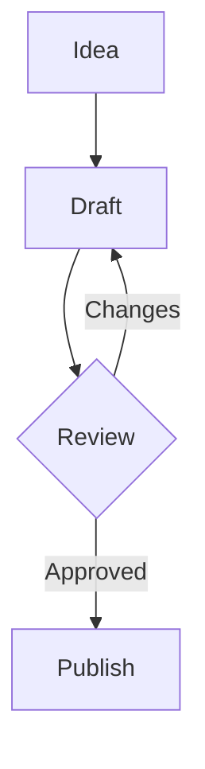

# Markdown Slides

A slide deck in Libera is one Markdown file named `*.slides.md` (or
`*.slides.markdown`). It is stored, saved, synced and searched like any other
note, and it opens in the source editor with the slides beside it. Each slide
is laid out on a fixed canvas and scaled to fit wherever it is shown, so the
preview, the presentation and the PDF show the same slide.

A file named `talk.md` stays a normal note, even if it contains `---` lines or
`$key = value` lines.

## Creating a deck

**New slides** in a notebook's menu, on a notebook's home, or in the empty
workspace creates a deck. The name defaults to `Untitled.slides.md`, and a
name typed without the marker gets it: `Lecture 01` and `Lecture 01.md` both
become `Lecture 01.slides.md`.

## A complete example

````markdown
$title = Results from the field
$subtitle = Spring survey, $n = 412$
$author = ["Ada Lovelace", "Grace Hopper"]
$affiliation = Analytical Engine Lab
$date = October 2026
$theme = light
---
## What we measured

- Response time
- Error rate

--

- This appears on the next click

???
Speaker notes: only the presenter sees these.
---
$layout = section
## Part 2: Results
---
$columns = [2, 3]
## Text beside a diagram

- Ideas start small
- Review loops back

|||


---
## Revenue

```chart
type: bar
labels: [Q1, Q2, Q3, Q4]
series:
  2025: [12, 19, 8, 15]
  2026: [14, 22, 11, 18]
```
````

## Structure

- A line containing only `---` starts a new slide.
- The block above the first `---` is the deck: its settings, and the title
  slide drawn from `$title`, `$subtitle`, `$author`, `$affiliation` and
  `$date`. Body text in that block also appears on the title slide.
- A deck may open with YAML-style front matter instead (`---`, then
  `title: …` lines and `- item` lists, then `---`).
- A slide with no title and no content is skipped.
- Markers (`---`, `--`, `|||`, `???`) inside code fences and multi-line HTML
  comments are ignored, so `<!-- … -->` comments out a whole slide.

### Slide titles

A leading `#` or `##` heading becomes the slide's title, drawn in the slide
header with an accent rule under it. `$title = …` works too. On the deck block,
a leading `#` heading names the deck.

### Settings

`$key = value` lines go at the top of a block, or right under a slide's title
heading. A value is a JSON literal (`"text"`, `21`, `true`, `["a", "b"]`) or
plain text (`$theme = night`). Settings stop at the first line of content, so
later `$…` lines are content (inline math such as `$x$` is never a setting).

A value that cannot be used (an unknown theme, a malformed list) is listed
above the preview; the deck still renders with the rest.

**Deck settings** (in the deck block):

| Setting | Values | Default |
| --- | --- | --- |
| `$title`, `$subtitle`, `$date` | text | |
| `$author`, `$affiliation` | text, or a list | |
| `$theme` | `light`, `dark`, `paper`, `night` | `light` |
| `$accent` | any CSS color, for title rules, links and focus rings | the theme's |
| `$aspect` | `16:9`, `16:10`, `4:3` | `16:9` |
| `$fontsize` | body text size in canvas pixels (the canvas is 540 high) | `21` |
| `$footer` | text, or `false` to hide it | title and authors |
| `$paginate` | `false` hides slide numbers | `true` |
| `$transition` | `fade`, `slide`, `none` | `fade` |
| `$fit` | `false` turns off shrink-to-fit | `true` |
| `citation-style` | a citation style such as `ieee`, as in notes (usually in front matter: `citation-style: ieee`) | the notebook's |

**Slide settings** (at the top of a slide):

| Setting | Values |
| --- | --- |
| `$title` | the slide title, instead of a heading |
| `$layout` | `default`, `top`, `center`, `section`, `blank` (see Layouts) |
| `$columns` | relative column widths, such as `[2, 1]` (see Columns) |
| `$fontsize` | body text size for this slide |
| `$background` | a CSS color |
| `$fit` | `false` turns off shrink-to-fit for this slide |
| `$hidden` | `true` keeps a backup slide in the file but out of the presentation and the PDF |

## Layouts

| `$layout` | What it does |
| --- | --- |
| `default` | Title at the top; the body is centered vertically in the space below. |
| `top` | Like `default`, but the body starts right under the title. Use it for dense slides. |
| `center` | Title and body centered horizontally and vertically. Lists stay left-aligned inside. Good for a statement, a quote or a big number. |
| `section` | A divider: a large title with an accent rule, and any body as a muted subtitle. |
| `blank` | No header, footer or padding. An image alone in the body fills the slide. Use it for a full-bleed photo. |

Images that are alone in a paragraph are centered.

## Columns

A line containing only `|||` starts a new column. A slide can have any number
of columns, side by side under the title. They are equal width unless
`$columns` lists relative widths:

```markdown
---
$columns = [2, 3]
## Text beside a picture

- Ideas start small
- Review loops back

|||


```

- An empty column keeps its place, which leaves a gap.
- Build steps carry across columns: put `--` before a `|||` to make the next
  column appear on a click.
- Charts, diagrams and live HTML take the width of their column. A diagram is
  never taller than the slide body, so a tall one shrinks on its own instead
  of shrinking the slide's text.

## Builds

`--` on its own line, after a blank line, is a build step: what follows appears
on the next click. Hidden steps keep their space, so nothing moves when they
appear. (Right under a line of text, `--` would make that text a heading, so it
only counts after a blank line.)

## Speaker notes

`???` on its own line starts the slide's speaker notes: everything after it on
that slide. Notes show under each slide in the preview and in the presenter's
speaker view, never on the slide or in the PDF.

## Content

Slide bodies use the same Markdown renderer as notes:

- GitHub-flavored Markdown: lists, tables, task lists, links, images, code.
- Math with the notebook's inline and display markers (KaTeX).
- Libera's highlights, colored text and colored boxes.
- Citations (`[@key]`) from the notebook's References. They are numbered across
  the whole deck; put `:::bibliography` on a slide to place the reference list.
- Images and links relative to the deck file, as in notes.
- ```` ```chart ```` blocks: charts from a few lines of YAML or CSV.
- ```` ```mermaid ```` blocks: flowcharts, sequence, class, state and ER
  diagrams, Gantt charts, pies, mind maps, timelines and more.
- ```` ```html live ```` blocks: HTML, CSS and JavaScript run in a sandboxed
  frame, for interactive figures, calculators or custom charts.

The three live blocks follow the deck's `$theme` and print in the PDF. See
[Charts, diagrams and live HTML](features/charts-and-live-html.md) for their
settings and safety rules.

### Fitting

When a slide has more content than fits, its body shrinks, down to about half
size, reflowing at a wider width so text gets smaller rather than just cut. Past
that, the preview flags the slide as overfull. `$fit = false` turns this off.
Long slides are better split in two, or set to `$layout = top` with a smaller
`$fontsize`.

## Preview

The preview beside the source shows every slide, follows the caret, and puts
the caret on a slide when you click it. Warnings about settings show above the
slides, and speaker notes under each one. Slides use the deck's theme, not the
app's light or dark mode.

## Presenting

**Present slides** in the toolbar, or **Present from here** above any slide,
starts the presentation in full screen, using the editor's current text (no
need to save first).

| Key | Action |
| --- | --- |
| →, Space, PageDown, N, click | Next step or slide |
| ←, PageUp, P, right-click | Previous step or slide |
| ↓ / ↑ | Next / previous slide, skipping build steps |
| Home / End | First / last slide |
| a number, then Enter | Jump to that slide |
| G | Overview of every slide |
| S | Speaker view: current slide, next step, notes, timer and clock (T resets the timer) |
| B or `.` / W or `,` | Blank the screen black / white |
| ? | List the shortcuts |
| Esc | Close an overlay, or end the presentation |

Keys pressed inside a live HTML block still move the slides, unless focus is in
a text field.

## PDF export

**Download → PDF file** in the file actions menu (desktop app) prints the deck
one slide per page, at the slide's own size, with every build step shown and
hidden slides left out. Libera waits for charts, diagrams and live blocks to
finish drawing first.

## How it works

- `src/lib/markdown-slides.ts` parses a deck into slides, segments (build steps
  and columns), notes and settings, with the warnings shown above the preview.
- `src/components/libera/markdown-slide-templates.tsx` draws a slide: the
  header, layouts, columns and shrink-to-fit (`FitBody`).
- `src/components/libera/markdown-slides-viewer.tsx` holds the preview, the
  presenter and the PDF export pages.
- `src/components/libera/slide-live-blocks.tsx` renders charts, diagrams and
  live HTML.
- The Libera agent's `slide-deck` skill (`src/lib/agent/skills/slide-deck.ts`)
  teaches the agent this format; see [the agent's skills](features/ai-agent.md#slide-deck).
